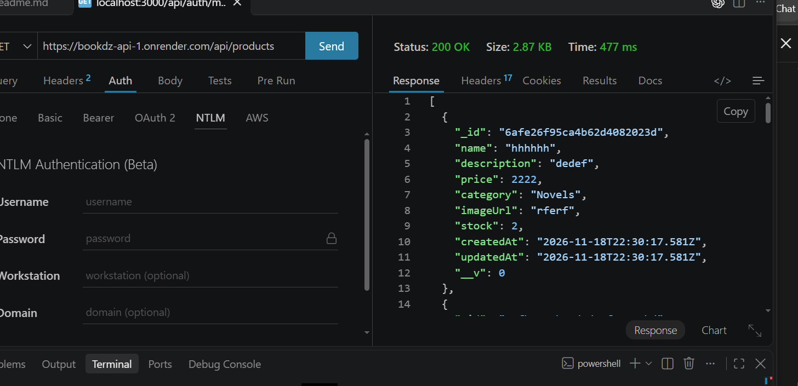

# BookDZ API

REST API for the BookDZ online bookstore, built with Node.js, Express and MongoDB.
It handles products (books), user accounts, JWT authentication, OAuth 2.0 (Auth0) and rate limiting.

**Student:** Manal Boutria, ENSTA (National Higher School of Advanced Technologies), WAMD module, TD-TP 3

- Live API: https://bookdz-api-1.onrender.com
- Frontend (React + Redux): https://bookdz-store.vercel.app (repo: `ManelBoutria/bookdz-store`)

> The API is hosted on a free Render plan. After a period of inactivity the first request can take up to 50 seconds.

## Technologies

- Node.js and Express
- MongoDB with Mongoose (MongoDB Atlas online, local MongoDB for development)
- JSON Web Tokens (`jsonwebtoken`) and `bcryptjs` for passwords
- OAuth 2.0 with Auth0 (Authorization Code flow)
- `express-rate-limit`, `cors`, `dotenv`, `nodemon`

## Database models

**Product**: `name` (required), `description`, `price` (required, min 0), `category` (default "General"), `imageUrl`, `stock` (default 0, min 0), timestamps.

**User**: `name`, `email` (unique), `passwordHash`, `role` (`customer` or `admin`, default `customer`), timestamps.

## Roles

- **Customer**: created by public registration. Can browse books and use the cart.
- **Admin (seller)**: created only by the seed script from `ADMIN_EMAIL` and `ADMIN_PASSWORD`. Can add, edit and delete books.

Nobody can register as admin through the API.

## Endpoints

| Method | Route | Access | Description |
|--------|-------|--------|-------------|
| GET | `/` | Public | API status |
| POST | `/api/auth/register` | Public | Create a customer account (201, 400, 409) |
| POST | `/api/auth/login` | Public, limited to 5 per 15 min | Returns a JWT and the user (200, 400, 401, 429) |
| GET | `/api/auth/me` | JWT or OAuth token | Current user (200, 401) |
| GET | `/api/products` | Public | List books, optional `?category=` |
| GET | `/api/products/:id` | Public | One book (200, 400 invalid id, 404) |
| POST | `/api/products` | Admin | Create a book (201, 400, 401, 403) |
| PUT | `/api/products/:id` | Admin | Update a book (200, 400, 401, 403, 404) |
| DELETE | `/api/products/:id` | Admin | Delete a book (200, 400, 401, 403, 404) |

Every `/api` route is also limited to 100 requests per 15 minutes per IP (429 when exceeded).

## Authentication

1. `POST /api/auth/login` returns a JWT (valid 1 day, payload `{ id, role }`).
2. Protected routes need the header `Authorization: Bearer <token>`.
3. Missing, invalid or expired token gives `401`. A valid token without the admin role on an admin route gives `403`.

### OAuth 2.0 (Auth0)

Protected routes also accept an OAuth 2.0 access token issued by Auth0. The token is obtained with the Authorization Code flow (tested in Thunder Client). The API checks it by calling the Auth0 `/userinfo` endpoint. OAuth users get the `customer` role, so they cannot use admin routes.

## Installation

```bash
git clone https://github.com/ManelBoutria/bookdz-api.git
cd bookdz-api
npm install
```

Create a `.env` file (see `.env.example`):

```
PORT=3000
MONGODB_URI=mongodb://127.0.0.1:27017/bookdz
JWT_SECRET=choose_a_long_random_secret
ADMIN_EMAIL=admin@bookdz.com
ADMIN_PASSWORD=choose_an_admin_password
CLIENT_ORIGIN=http://localhost:5173
AUTH0_DOMAIN=your_auth0_domain
```

`MONGODB_URI` can be a local MongoDB or a MongoDB Atlas connection string. The `.env` file is never committed.

## Run

```bash
npm run seed   # inserts 9 sample books and creates the admin account
npm run dev    # development, restarts on changes (nodemon)
npm start      # production
```

The server runs on `http://localhost:3000`.

## Project structure

```
config/db.js            MongoDB connection
models/                 Product.js, User.js
middleware/             auth.js (JWT, OAuth, admin check), rateLimiters.js
routes/                 authRoutes.js, productRoutes.js
server.js               app setup, CORS, rate limit, error handling
seed.js                 sample data and admin account

```
## TEST 


## Deployment

- API on Render (build `npm install`, start `npm start`) with environment variables set in the Render dashboard.
- Database on MongoDB Atlas.
- Frontend on Vercel with `VITE_API_URL` pointing to the Render URL.